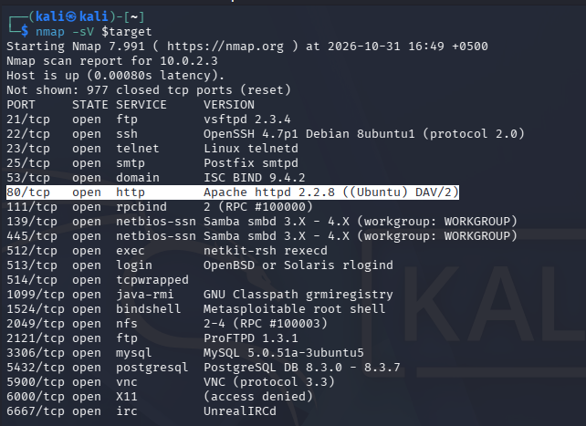
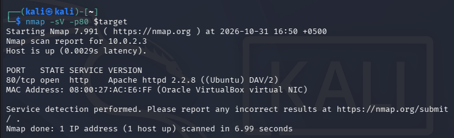
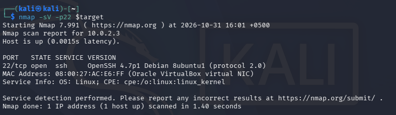

<table style="width:99%;">
<colgroup>
<col style="width: 14%" />
<col style="width: 16%" />
<col style="width: 19%" />
<col style="width: 16%" />
<col style="width: 21%" />
<col style="width: 11%" />
</colgroup>
<thead>
<tr>
<th style="text-align: left;">
Type
</th>
<th style="text-align: left;">
Definition
</th>
<th style="text-align: left;">
Example
</th>
<th style="text-align: left;">
How it spread
</th>
<th style="text-align: left;">
Primary Impact
</th>
<th style="text-align: left;">
Ref
</th>
</tr>
</thead>
<tbody>
<tr>
<td style="text-align: left;">
Virus
</td>
<td style="text-align: left;">
Malicious malware that attaches itself to host (files) and uses them to spread/replicate across the system.
</td>
<td style="text-align: left;">
Melissa Virus, 1999
</td>
<td style="text-align: left;">
Via uploading a Microsoft Word file to an online newsgroup, which promised free passwords to adult websites. Once the file was opened, the virus automatically emailed copies of itself to the first 50 people in their Outlook address book, tricking more people and overwhelming email servers
</td>
<td><ul>
<li>
$80 million for repair and cleanup of affected devices
</li>
<li>
Nearly 1 million accounts affected
</li>
<li>
Internet traffic slowed to a crawl in multiple locations
</li>
</ul></td>
<td style="text-align: left;"><ul>
<li></li>
</ul>

[1], [2]
</td>
</tr>
<tr>
<td style="text-align: left;">
Worm
</td>
<td style="text-align: left;">
Self-replicating malware that can spread across a network by exploiting security vulnerabilities
</td>
<td style="text-align: left;">
SQL Slammer Worm 2003
</td>
<td style="text-align: left;">
Fileless worm that remotely exploited a stack-based buffer overflow vulnerability (CVE-CAN-2002-0649) in Microsoft SQL Server 2000.
</td>
<td><ul>
<li>
Internet crash within 15 minutes, causing congestions, overloads and packet loss
</li>
<li>
$1 billion in recovery loss
</li>
<li>
$1.2 billion in lost productivity
</li>
<li>
Crashed digital monitoring system at the Davis-Besse nuclear power plant
</li>
</ul></td>
<td style="text-align: left;"><ul>
<li>
[1]
</li>
</ul></td>
</tr>
<tr>
<td style="text-align: left;">
Trojan
</td>
<td style="text-align: left;">
Legitimate-looking file that tricks user into executing it; leads to backdoor access
</td>
<td style="text-align: left;">
Emotet

2014-2021
</td>
<td style="text-align: left;">
Use phishing emails and links to launch payloads when clicked.

Spreads through network by brute-forcing credentials
</td>
<td><ul>
<li>
$1 billion recovery loss
</li>
<li></li>
</ul></td>
<td style="text-align: left;"><ul>
<li>
[1], [3]
</li>
</ul></td>
</tr>
<tr>
<td style="text-align: left;">
Ransomware
</td>
<td style="text-align: left;">
Malware that encrypts or locks files/system until the demanded sum is provided.
</td>
<td style="text-align: left;">
WannaCry 2017
</td>
<td style="text-align: left;">
Exploited a vulnerability called "EternalBlue” that worked on older, unpatched versions of Microsoft Windows.

It then encrypted files and demanded ransom payments in Bitcoin for decryption keys.
</td>
<td><ul>
<li>
Affected UK’s National Health Service (NHS)
</li>
<li>
70,000 devices infected and about 19,000 medical appointments or procedures being cancelled
</li>
<li></li>
</ul></td>
<td style="text-align: left;"><ul>
<li>
[1], [4]
</li>
</ul></td>
</tr>
<tr>
<td style="text-align: left;">
Spyware
</td>
<td style="text-align: left;">
Malware that secretly records information and collects private credentials such as passwords
</td>
<td style="text-align: left;">
Pegasus
</td>
<td style="text-align: left;">
Exploits zero-day vulnerabilities to enter and remain undetectable on mobile devices and can turn on GPS, record audio, turn on the camera and track communications
</td>
<td><ul>
<li>
Used to provide information on journalists who were later murdered
</li>
</ul></td>
<td style="text-align: left;"></td>
</tr>
<tr>
<td style="text-align: left;">
Adware
</td>
<td style="text-align: left;">
Frequent, massive adstreams that can track user behaviour.
</td>
<td style="text-align: left;">
SimBad, 2019
</td>
<td style="text-align: left;">
 Distributed through the RXDroider Software Development Kit used by Developers in multiple application. Users were affected when they installed these application
</td>
<td><ul>
<li>
Redirected users to malicious websites and phishing pages via ads.
</li>
<li>
Could install additional malicious software
</li>
</ul></td>
<td style="text-align: left;"><ul>
<li></li>
</ul></td>
</tr>
<tr>
<td style="text-align: left;">
Rootkit
</td>
<td style="text-align: left;">
Malware that embeds itself into hidden files to avoid detection by system tools and allows unauthorised root access
</td>
<td style="text-align: left;">
Sony BMG, 2005
</td>
<td style="text-align: left;">
Spread through music CDs distributed by Sony BMG that contained Extended Copy Protection (XCP) software, which launched hidden components on users' computers when installed by users.
</td>
<td><ul>
<li>
Restricted user’s CD use
</li>
<li>
Monitored user’s listening habits without consent
</li>
</ul></td>
<td style="text-align: left;"></td>
</tr>
<tr>
<td style="text-align: left;">
Keylogger
</td>
<td style="text-align: left;">
Malware that secretly captures keystrokes on a user’s device to monitor activity and track sensitive information such as credit card information
</td>
<td style="text-align: left;">
LastPass Breach
</td>
<td style="text-align: left;">
Keylogging malware installed on a DevOps’ home computer which had been compromised by use of vulnerable third-party software.

It then recorded the keystrokes, enabling the hacker to capture the master password for the employee’s password vault at <a href="https://www.pcmag.com/reviews/lastpass">LastPass</a>. It also helped the hacker bypass the <a href="https://www.pcmag.com/how-to/multi-factor-authentication-2fa-who-has-it-and-how-to-set-it-up">multi-factor authentication</a> on the account, which contained the decryption keys required to access LastPass’s cloud backup system
</td>
<td><ul>
<li>
sensitive company information, configuration data , API secrets and customer password vault backups were compromised
</li>
<li>
Exposed customer information
</li>
</ul></td>
<td style="text-align: left;"></td>
</tr>
<tr>
<td style="text-align: left;">
Botnet agent
</td>
<td style="text-align: left;">
Malicious code used to manage and control a network of computers, also known as a “botnet.”
</td>
<td style="text-align: left;">
Mirai, 2016
</td>
<td style="text-align: left;">
Scanned devices on the Internet for known vulnerabilities and default or weak login credentials. Once compromised, these devices became remotely controlled members of the botnet.
</td>
<td><ul>
<li>
Infected devices were used to launch DDoS attacks
</li>
<li>
Over 100,000 primarily U.S.-based computing devices compromised were used for advertising fraud
</li>
</ul></td>
<td style="text-align: left;"></td>
</tr>
<tr>
<td style="text-align: left;">
Fileless/living-off-the-land
</td>
<td style="text-align: left;">
Malicious software that runs in memory and uses legitimate tools to conduct malicious activities
</td>
<td style="text-align: left;">
Astaroth (2019)
</td>
<td style="text-align: left;">
Victims were sent phishing emails that downloaded a ZIP archive containing a malicious shortcut (LNK) file. It then used legitimate Windows utilities, including WMIC, Bitsadmin, Certutil and Regsvr32, to download, decode and execute malicious code.
</td>
<td style="text-align: left;"><ul>
<li>
Sensitive information including credentials compromised.
</li>
<li>
Financial theft and selling of victim data
</li>
</ul></td>
<td style="text-align: left;"></td>
</tr>
<tr>
<td style="text-align: left;">
Logic Bomb
</td>
<td style="text-align: left;">
Malicious code that is activated when a specific condition is met (certain logic is true), leading to harm
</td>
<td style="text-align: left;">
UBS PaineWebber(2002)
</td>
<td style="text-align: left;">
A former UBS PaineWebber systems administrator, Roger Duronio planted a logic bomb within the company's computer network using his own administrative access. About 1,000 networked computers were affected. The program was designed to activate on a predetermined date.
</td>
<td><ul>
<li>
File deletions across affected computers
</li>
<li>
More than $3 million in assessment and recovery costs.
</li>
</ul></td>
<td style="text-align: left;"></td>
</tr>
<tr>
<td style="text-align: left;">
Bootkit
</td>
<td style="text-align: left;">
Malicious code that executes before system boots and therefore avoids standard OS processes and system security checks
</td>
<td style="text-align: left;">
BlackLotus (2023)
</td>
<td style="text-align: left;">
Exploited a Windows Secure Boot vulnerability, CVE-2022-21894 (Baton Drop) to first obtain administrative privileges or physical access to the target device. It then bypassed Secure Boot protections and installed malicious bootloader files in the EFI System Partition.
</td>
<td><ul>
<li>
Disabled Windows security mechanisms such as BitLocker, Microsoft Defender Antivirus and Hypervisor-Protected Code Integrity (HVCI),
</li>
<li>
Difficult to detect and remove
</li>
</ul></td>
<td style="text-align: left;"></td>
</tr>
</tbody>
</table>

References:

\[1\] “Types of Malware: How to Detect, Prevent, and Stay Protected \| Fortinet.” Accessed: Nov. 02, 2026. \[Online\]. Available: https://www.fortinet.com/resources/cyberglossary/types-of-malware

\[2\] “The Melissa Virus — FBI.” Accessed: Nov. 02, 2026. \[Online\]. Available: https://www.fbi.gov/news/stories/melissa-virus-20th-anniversary-032519

\[3\] “Emotet Malware \| CISA.” Accessed: Nov. 02, 2026. \[Online\]. Available: https://www.cisa.gov/news-events/cybersecurity-advisories/aa20-280a

\[4\] “What was the WannaCry ransomware attack?” Accessed: Nov. 02, 2026. \[Online\]. Available: https://www.cloudflare.com/learning/security/ransomware/wannacry-ransomware/

 

Task B:

B1:

Configured Network interfaces configured on the Kali Linux VM, including assigned IP addresses and operational states.

VM routing config.

Kali Linux VM cannot reach the external IP address 8.8.8.8, indicating the absence of external network connectivity.

