# Task A:

**<u>POC 1:</u>**

**TITLE** Outdated and Unsupported Apache HTTP Server Version 2.2.8

**SEVERITY** 9.0 Critical

**VECTOR** CVSS:3.1/AV:N/AC:H/PR:N/UI:N/S:C/C:H/I:H/A:H

**ASSET** 10.0.2.3 Port 80 Apache httpd 2.2.8

**IDENTIFIERS** CWE: CWE-1104 – Use of Unmaintained Third Party Components.

**DESCRIPTION**

The web server is identified as Apache HTTP Server 2.2.8 which has been declared end-of-life in December 2017 by The Apache Software Foundation.

Since this branch does not receive normal upstream security maintenance, continuing to operate it increases the risk of exposure to known and subsequently discovered security issues.

**EVIDENCE**

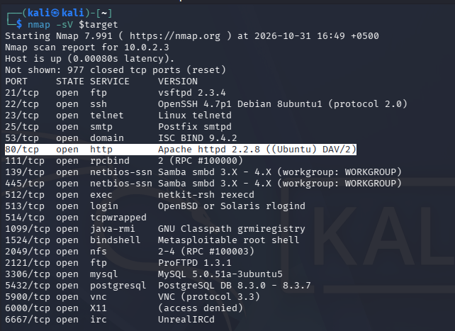

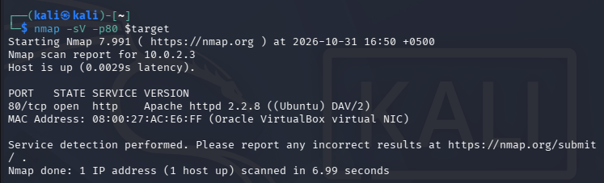

**PROOF OF CONCEPT**

Step 1: Run ‘nmap -sV -p 80 \<target_IP\>’

Step 2: Observe version

**IMPACT** The server may contain unpatched security weaknesses. Depending on the enabled configuration, exploitation of present vulnerabilities could result in information disclosure, denial of service or other compromise of the web service.

**REMEDIATION**

1.  Upgrade Apache server to a supported release.

2.  Review Apache configuration and enabled modules.

3.  Apply OS security updates.

4.  Verify the installed package version and patch status after upgrading.

**REFERENCES**

<https://cwe.mitre.org/data/definitions/1104.html>

<https://httpd.apache.org/security/vulnerabilities_22>

**<u>POC 2:</u>**

**TITLE** SSH Supports Weak Cryptographic Algorithms and Legacy Host Keys

**SEVERITY** 3.7 Low

**VECTOR** CVSS:3.1/AV:N/AC:H/PR:N/UI:N/S:U/C:L/I:N/A:N

**ASSET** 10.0.2.3 TCP Port 22 OpenSSH 4.7p1 Debian 8ubuntu1

**IDENTIFIERS** CWE-327 : Use of a Broken or Risky Cryptographic Algorithm.

CVE: CVE-2008-5161

**DESCRIPTION**

Multiple legacy cryptographic algorithms are supported by the server including :

1.  host-key enumeration identified:

- DSA: 1024 bits.

2.  The algorithm enumeration identified:

    **Encryption algorithms:**

- 3des-cbc

- arcfour

- aes128-cbc

> **Key-exchange algorithm:**

- diffie-hellman-group1-sha1

> **Message authentication algorithms:**

- hmac-md5

- hmac-sha1

The above-mentioned key configurations and algorithms include outdated cryptographic choices that might weaken the security of SSH communications.

**EVIDENCE**

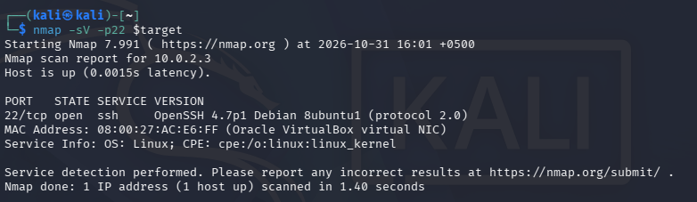

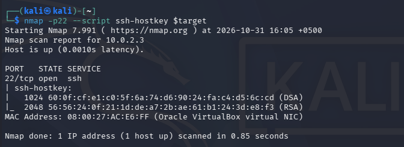

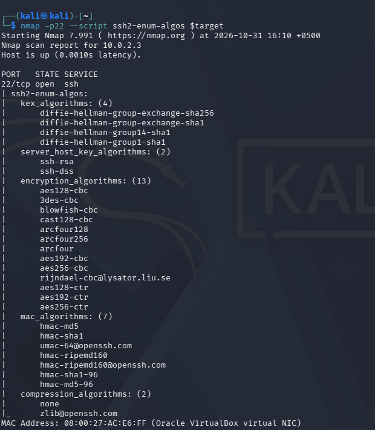

**PROOF OF CONCEPT**

Following nmap commands were used:

Step 1: ‘nmap -sV -p22 \<target_IP\>’

Step 2: ‘nmap -p22 --script ssh-hostkey \<target_IP\>’

Step 3: ‘nmap -p22 --script ssh-enum-algos \<target_IP\>’

**IMPACT** Using outdated cryptographic algorithms reduces the confidentiality and integrity protections of SSH. Under applicable conditions, these weaknesses may increase the possibility of information disclosure or cryptographic attacks.

**REMEDIATION**

1.  Upgrade OpenSSH to a currently supported release.

2.  Disable DSA host keys and replace them with modern supported key types.

3.  Disable legacy cipher including RC4, legacy CBC-mode ciphers, and Diffie-hellman-group1-sha1.

4.  Replace MD5- and SHA-1-based MAC algorithms with stronger supported alternatives.

5.  Verify the installed OpenSSH package revision and patch status.

**REFERENCES**

<https://cwe.mitre.org/data/definitions/327.html>

<https://nvd.nist.gov/vuln/detail/cve-2008-5161>

**<u>POC 3:</u>**

**TITLE** Publicly Accessible phpinfo() Page exposes configuration information

**SEVERITY** 3.7 Low

**VECTOR** CVSS:3.1/AV:N/AC:H/PR:N/UI:N/S:U/C:L/I:N/A:N

**ASSET** 10.0.2.3 TCP Port 80 OpenSSH 4.7p1 Debian 8ubuntu1

**IDENTIFIERS** CWE: CWE-200 – Exposure of Sensitive Information to an Unauthorized Actor

**DESCRIPTION**

The PHP diagnostic page was accessible without authentication through the web server. The page returned HTTP 200 and displayed PHP configuration information, including the PHP version (5.2.4).

This type of public exposure of a phpinfo() page can disclose information about the server environment, loaded extensions, PHP configuration ,filesystem paths and other runtime details. This information can be used by attackers to identify further attack opportunities.

**EVIDENCE**

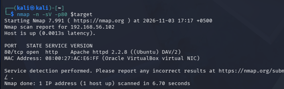

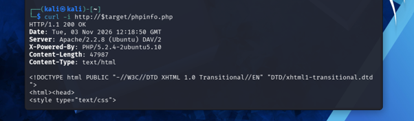

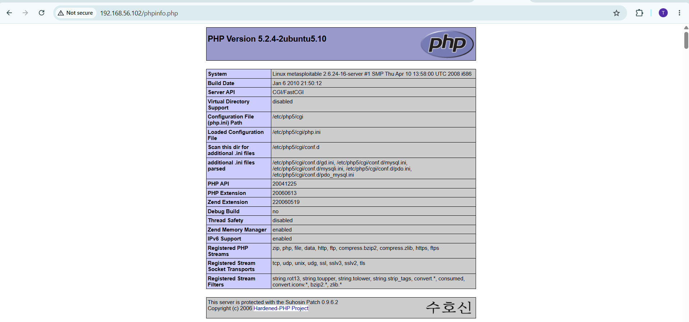

**PROOF OF CONCEPT**

Following nmap commands were used:

Step 1: ‘nmap -sV -p80 \<target_IP\>’

Step 2: ‘curl -i http://\$target/phpinfo.php’

**IMPACT** Unauthorised access to technical information about the server environment could be used to assist with service fingerprinting, identification of outdated components and selection of further attack techniques.

**REMEDIATION**

1.  Remove publicly accessible phpinfo() diagnostic files from the web root.

2.  Restrict diagnostic pages and files to authorised administrators only.

3.  Upgrade PHP to a currently supported release.

4.  Review the web root for other diagnostic or development files.

**REFERENCES**

https://cwe.mitre.org/data/definitions/200.html

https://www.php.net/releases/5_2_16.php

# Task B

**B1:**

Nmap scan

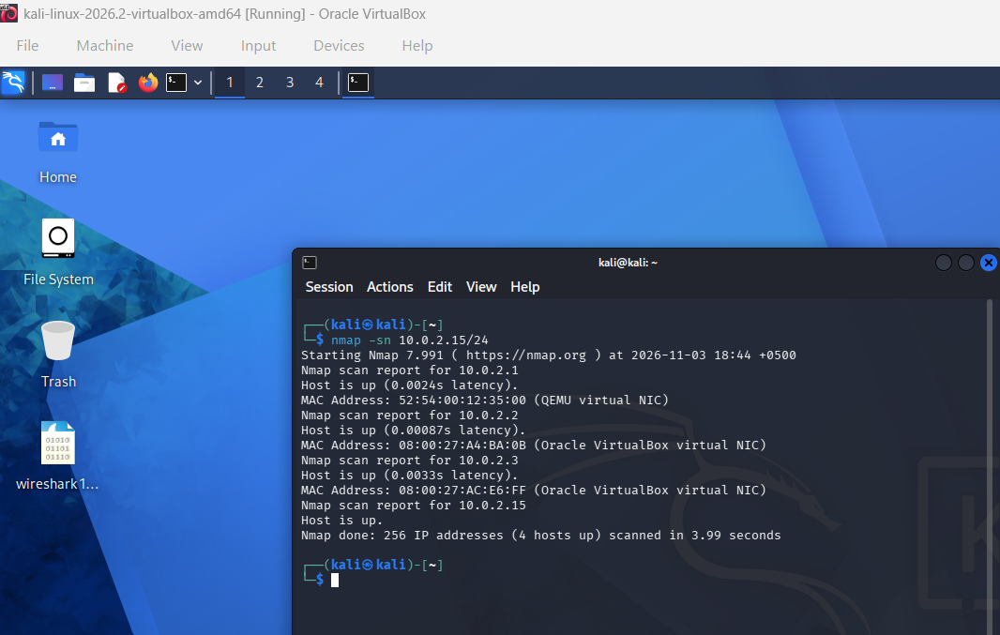

Netdiscover scan:

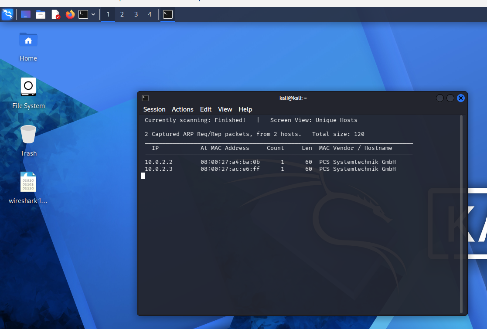

Ipscan:

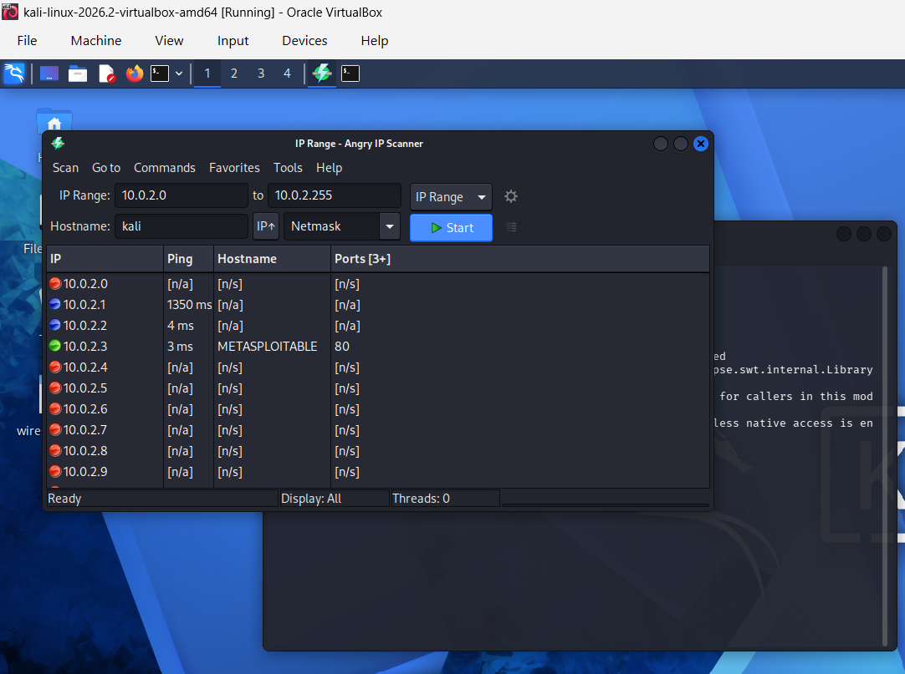

The Nmap scan shows a simple scan output within the terminal, stating which hosts are up and associated IPs and MAC addresses. Netdiscover reveals about the same information in a more structured layout including additional information about the packets. Ipscan works as a separate GUI with the availability to scan a range of IP addresses and provides hostname and ping response.

**B5:**

**Network Scanning:**

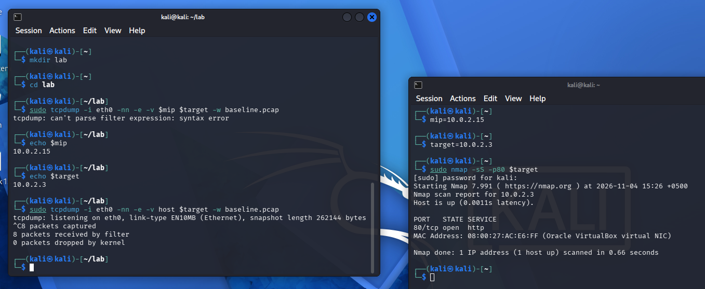

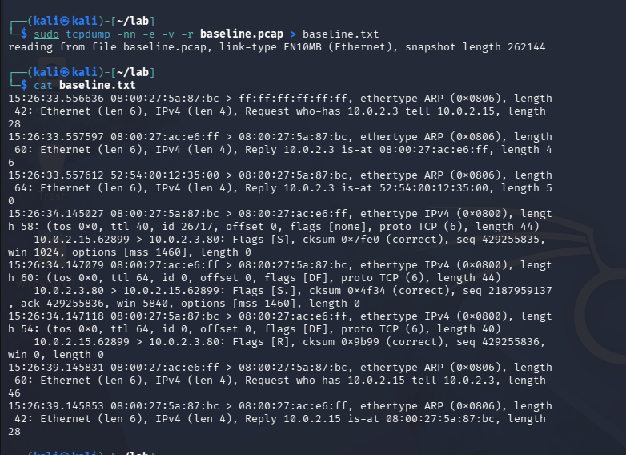

**Fragmentation:**

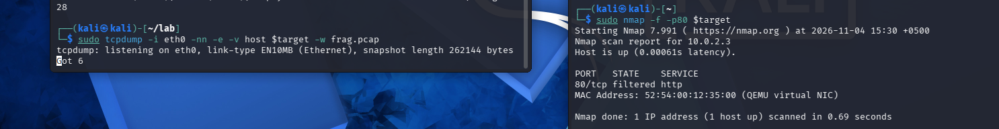

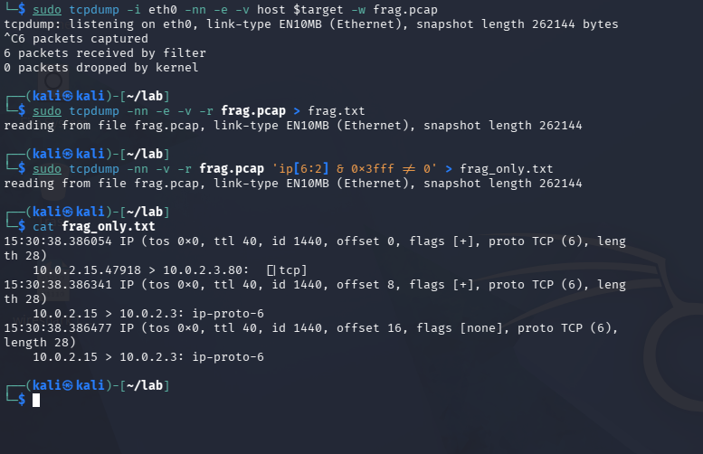

This nmap command send each packet as individual fragments. The tcpdump shows each probe to port 80 arrived as several small IP fragments instead of a single packet. The fragments had offsets 0, 8 and 16, and the More Fragments (MF) flag was set on all but the last. Only the first fragment showed the TCP port information, and the later ones appeared as bare ip-proto-6 packets. Since target Metasploitable still replied with a SYN-ACK, it shows that fragments were reassembled and the scan worked normally. This scantargets simple packet filters and older IDS that inspect packets individually, but modern firewalls reassemble fragments first, which limits its effectiveness.

**Decoys/Spoofing:**

**Creating decoys:**

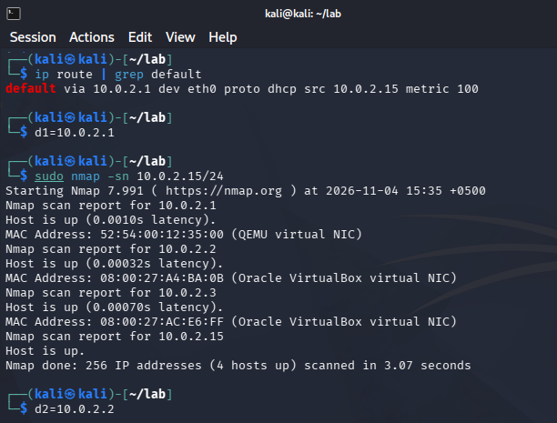

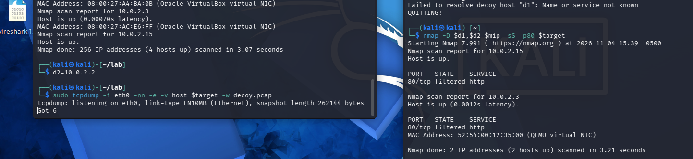

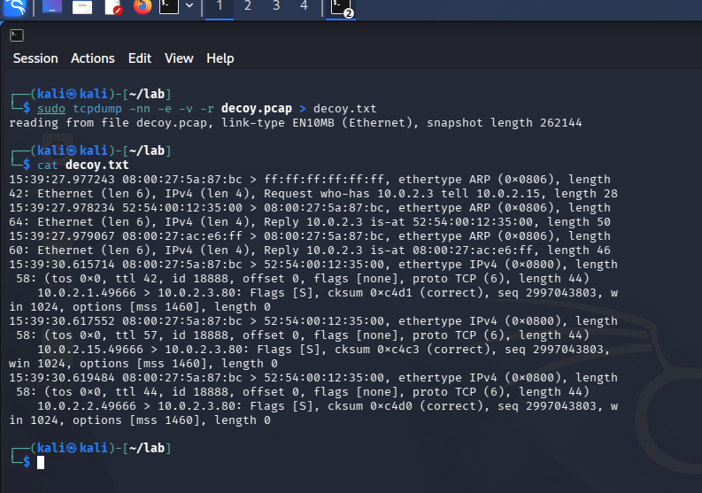

This Nmap command makes the scan appear to have come from different source addresses at once. The goal is to hide actual scanner (attacker) among the decoys, so an administrator reading the logs can’t easily identify the attacker. However, the real IP still appears in the logs, and on the same LAN also carries MAC address regardless of spoofed source IP, so origin is exposed. Since only real address receives the target’s replies, and TTL values can be compared , defenders can identify spoofing.
